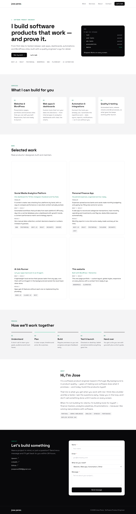
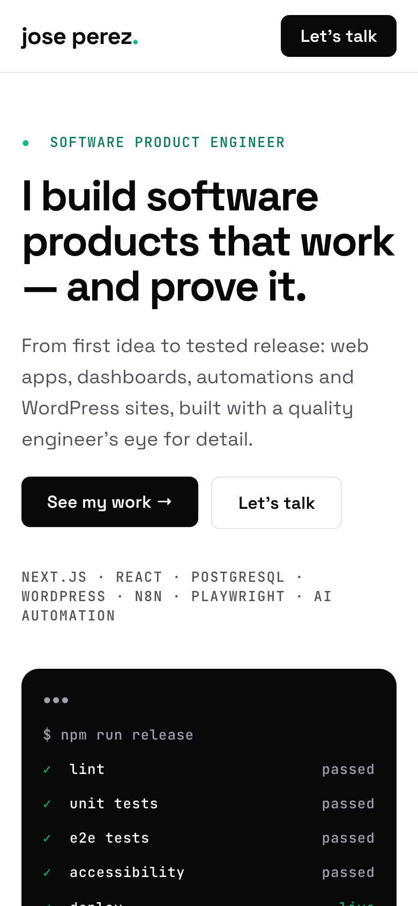

# Portfolio — WordPress + Elementor

My one-page portfolio as a **Software Product Engineer**, built in WordPress with Elementor (free) from a Penpot mockup. It doubles as a demo of how I implement a designer's layout in a page builder and hand it over to someone who doesn't code.

<p>
  
  
</p>

## What's in it

- **Design → build, 1:1.** Every Penpot flex board maps to an Elementor flexbox container with the same direction, gap and padding. Every color and font comes from Elementor's **Global Colors / Global Fonts** (seeded from the mockup's tokens), not hard-coded values.
- **Responsive** at desktop (1440), tablet (1024) and phone (390).
- **Client-friendly editing.** Every block has a readable name in Elementor's Structure panel (`Section · Work`, `Project · AI Job Runner`…), the repeating pieces (project card, service card, process step) are saved as templates, and a **"How to edit your site"** guide sits on the WordPress dashboard.
- **Contact form** with Fluent Forms, styled with the same design tokens.
- **Reproducible.** One script builds the whole site from scratch, so the setup is reviewable code, not clicks.

## Stack

WordPress 7 · Hello Elementor theme · Elementor (free) · Fluent Forms · MariaDB · Docker Compose · WP-CLI · Penpot (design)

## Run it locally

Needs Docker.

```sh
cp .env.example .env      # set passwords and admin email
./setup.sh                # ~2 minutes → http://localhost:8088
```

Admin is at `/wp-admin` with the user and password from `.env`. Use `PORT=8099 COMPOSE_PROJECT_NAME=other ./setup.sh` to run a second, independent copy.

## Files

| File | What it does |
|------|--------------|
| `setup.sh` | Fresh install end to end: WordPress, theme, plugins, design tokens, images, form, page |
| `kit.php` | Seeds Elementor's Global Colors and Global Fonts from the Penpot tokens |
| `scaffold-page.php` | Builds the home page as Elementor containers and widgets (one-time scaffold, see below) |
| `form.php` | Configures the Fluent Forms contact form |
| `mu-plugins/site-guide.php` | The "How to edit your site" dashboard guide |
| `assets/` | Headshot and project images |

### About `scaffold-page.php`

It generates the first version of the page. After that, **the Elementor editor is the source of truth**. The script refuses to run if the page was edited in Elementor since the last scaffold, because re-running would wipe those edits (`wp eval-file scaffold-page.php force` overrides).

## Notes

- Elementor Free has no mobile menu widget, so on phones the header shows the wordmark and the "Let's talk" button.
- A few layout rules Elementor Free has no setting for (sticky header, equal-width columns, form styling) live in **Additional CSS**, each with a plain-English comment.
- Locally, form messages are saved under **Fluent Forms → Entries**; sending them by email needs an SMTP plugin on a real host.
- Project screenshots have private numbers blurred or cropped out.
